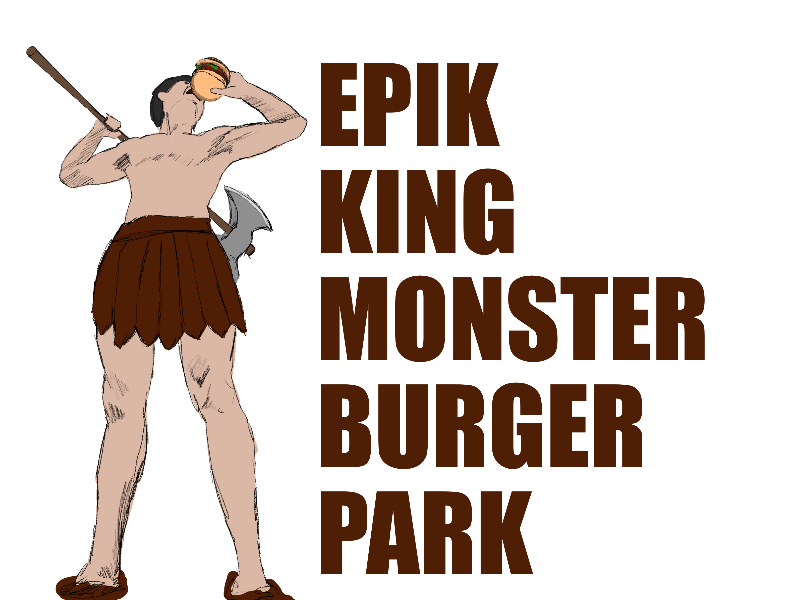
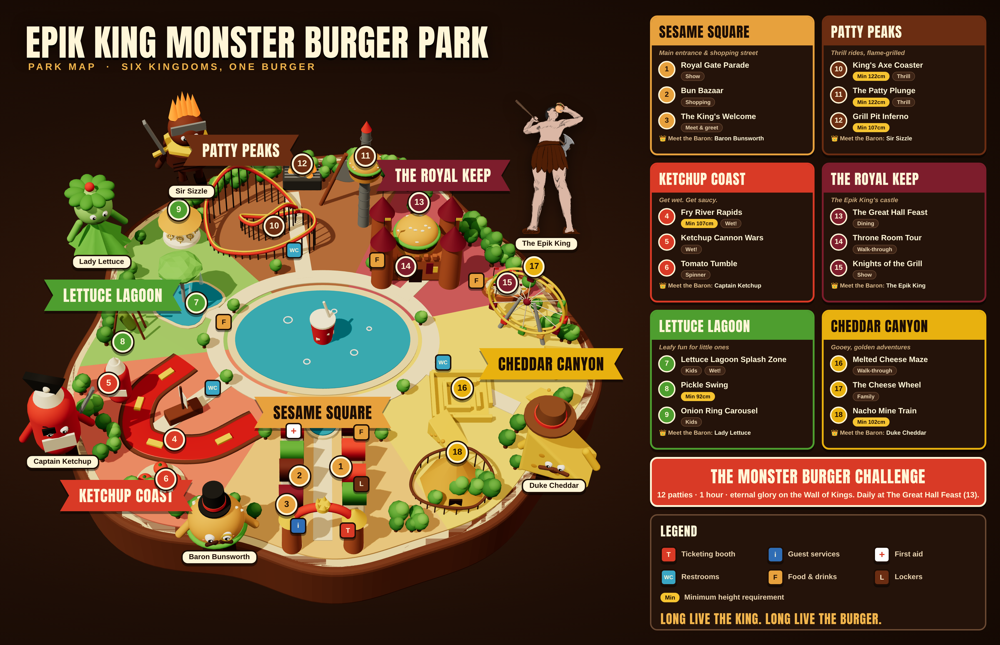

# 👑🍔 EPIK KING PRESENTS TO YOU: EPIK KING MONSTER BURGER PARK

> *"Bow before the him. Pick up the bruhgers and fries, die for him."*

Welcome to **EPIK KING Monster Burger Park**, Singapore's first and only theme park ruled by a burger-devouring, axe-wielding king.

Legend says the old King conquered every food kingdom in the land, but none of their feasts could fill him except one, BURGERLAND. So he tore everything down, and built his own kingdom, one made entirely for the pursuit of the ultimate burger. Today, ruled by his divine descendent, THE EPIK KING, its gates are open to all who dare to enter.

## 🏰 Explore the Kingdom

The park is divided into six areas, each inspired by a layer of the ultimate burger and arranged around the shimmering **Soda Sea**.

### 🟠 Sesame Square
*Main entrance & shopping street*
Enter through the Royal Gate and stroll down a street lined with sesame-topped market stalls. Catch the **Royal Gate Parade**, shop for souvenirs at the **Bun Bazaar**, and meet the Epik King himself at **The King's Welcome**.

### 🔴 Ketchup Coast
*Get wet. Get saucy.*
Ride golden fry rafts down the **Fry River Rapids**, blast other guests at **Ketchup Cannon Wars**, and spin until you're dizzy on the **Tomato Tumble**. Bring a change of clothes.

### 🟢 Lettuce Lagoon
*Leafy fun for little ones*
A splash-tastic zone for young royals. Get soaked by the giant lettuce bucket at the **Lettuce Lagoon Splash Zone**, swing high on the **Pickle Swing**, and ride the **Onion Ring Carousel**.

### 🟤 Patty Peaks
*Thrill rides, flame-grilled*
Home to the park's biggest thrills. Scream through the royal armoury on the **King's Axe Coaster**, free-fall 60 metres through a giant bun on **The Patty Plunge**, and brave the heat of the **Grill Pit Inferno**.

### 🍷 The Royal Keep
*The Epik King's castle*
Explore the King's burger-domed castle on the **Throne Room Tour** and watch knights battle it out at **Knights of the Grill**. Hungry? Take on the legendary **Monster Burger Challenge** at **The Great Hall Feast**: 12 patties, 1 hour, eternal glory.

### 🟡 Cheddar Canyon
*Gooey, golden adventures*
Find your way through the **Melted Cheese Maze**, take in views of the whole kingdom from **The Cheese Wheel**, and rattle through the tunnels of the **Nacho Mine Train**.

## 🎟️ Plan Your Visit

Open daily, including weekends and public holidays. Children under 5 enter **free**, because every future king starts somewhere.

Book your tickets through our online booking system, which checks your visiting date and gives you the right price for weekdays, weekends and public holidays.

**Long live EPIK. Long live BURGER.** 👑
